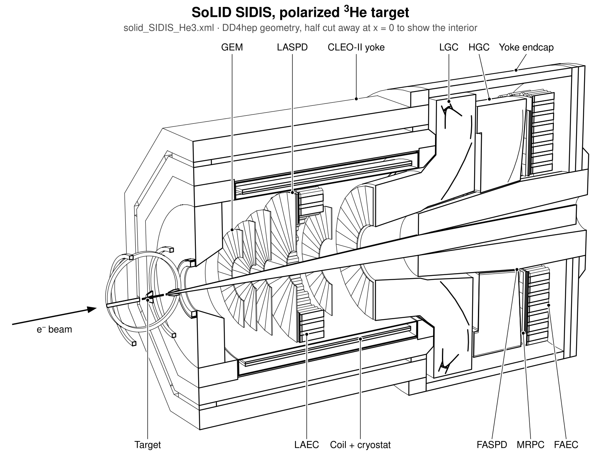
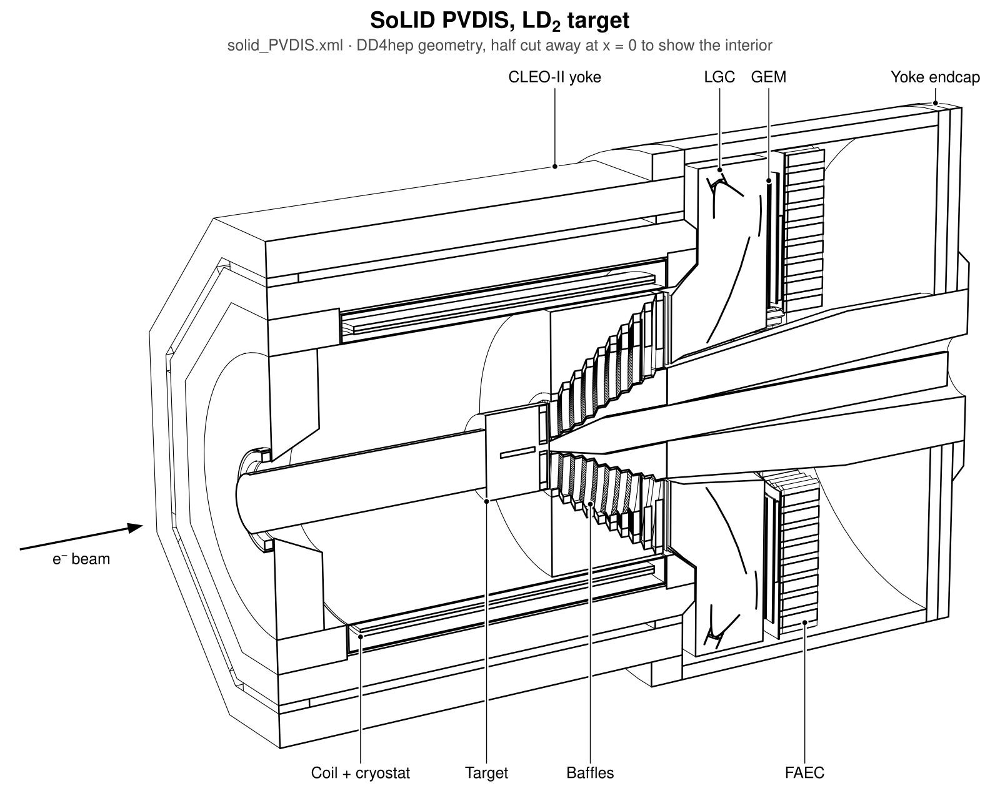
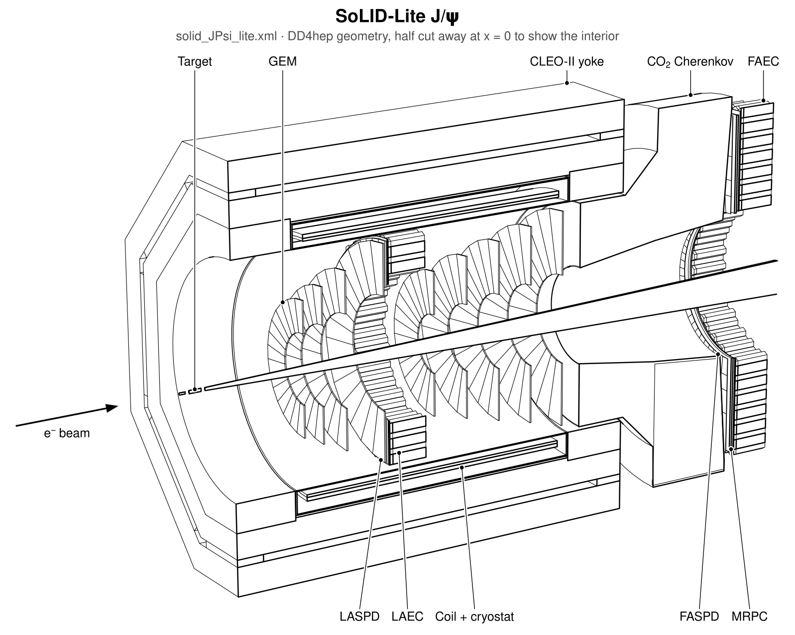

SoLID Detector Simulation (DD4hep)
==================================

DD4hep detector description and Geant4 simulation setup for SoLID (Solenoidal Large Intensity Device, JLab Hall A).
It covers full SoLID and the staged SoLID-Lite configurations, follows the
[EIC software](https://eic.github.io) conventions (DD4hep + ddsim/npsim + EDM4hep), and runs in the eic-shell container.

- [Wiki](https://solid.jlab.org/wiki/index.php/Meeting_solid_software#Using_EIC_software_for_SoLID_on_ifarm)
- Design and conventions: [docs/design.md](docs/design.md)
- Comparison with solid_gemc and the reference documents: [docs/geometry_comparison.md](docs/geometry_comparison.md)
- Line-view drawings (DAWN replacement): [docs/visualization.md](docs/visualization.md)
- Reconstruction framework and container environment: [docs/reconstruction.md](docs/reconstruction.md)

## Detector overview







*Full SoLID in its SIDIS (polarized ³He) and PVDIS (LD₂, baffles) setups, and SoLID-Lite J/ψ, drawn from the DD4hep
geometry with `make_solid_views --views overview`. The other configurations are linked in the table below.*

## Configurations

| compact file | experiment | magnet / field | GEMC reference | overview |
|---|---|---|---|---|
| `solid.xml` = `solid_SIDIS_He3.xml` | SIDIS, polarized 3He (40 cm, z = -350 cm) | CLEO-II, longer endcap (v4c) / v4c 2D map | solid_SIDIS_He3_moved_full | [drawing](docs/images/overview_solid_SIDIS_He3.svg) |
| `solid_SIDIS_NH3.xml` | SIDIS, polarized NH3 (+ 5 T target field) | v4c / v4c 2D map | solid_SIDIS_NH3_moved_full | [drawing](docs/images/overview_solid_SIDIS_NH3.svg) |
| `solid_PVDIS.xml` | PVDIS, 40 cm LD2 (z = +10 cm), baffles | v4c / v4c 2D map | solid_PVDIS_LD2_moved_full | [drawing](docs/images/overview_solid_PVDIS.svg) |
| `solid_JPsi.xml` | J/psi, 15 cm LH2 (z = -315 cm) | v4c / v4c 2D map | solid_JPsi_LH2_moved_full | [drawing](docs/images/overview_solid_JPsi.svg) |
| `solid_DDVCS.xml` | J/psi + DDVCS forward muon detector | v4c / v4c 2D map | solid_JPsi_DDVCS_LH2_moved_full | [drawing](docs/images/overview_solid_DDVCS.svg) |
| `solid_JPsi_lite.xml` | **SoLID-Lite** J/psi (stage 1) | CLEO-II iron as built / CLEOv10 | solid_JPsi_LH2_lite_full | [drawing](docs/images/overview_solid_JPsi_lite.svg) |
| `solid_DDVCS_lite.xml` | **SoLID-Lite** DDVCS | CLEO-II iron as built / CLEOv10 | solid_JPsi_DDVCS_LH2_lite_full | [drawing](docs/images/overview_solid_DDVCS_lite.svg) |
| `solid_beamtest.xml` | beam-test placeholder (telescope Cherenkov) | none | – | – |

Subsystems: CLEO-II solenoid (yoke, coil, cryostat), targets and beamlines, PVDIS baffles, GEM trackers, light-gas and
heavy-gas Cherenkovs (plus the SoLID-Lite CO2 Cherenkov), shashlik ECal (forward and large angle, with preshower),
scintillator pad detectors, forward MRPC, and the DDVCS muon system. All coordinates are in the GEMC hall frame:
z along the beam, origin at the coil center.

## Quick start

Get the container and build the geometry in it (Linux with Apptainer/Singularity; macOS and options:
[containers/README.md](containers/README.md)):

```bash
containers/install.sh --build
containers/solid-shell -c solid_JPsi_lite        # shell with the SoLID environment
```

The equivalent steps by hand, inside eic-shell or `containers/solid-shell`:

```bash
cmake -B build -S . -DCMAKE_INSTALL_PREFIX=install
cmake --build build -j4 && cmake --install build
source install/bin/thissolid.sh solid_JPsi_lite        # sets DETECTOR, DETECTOR_PATH, DETECTOR_CONFIG, LD_LIBRARY_PATH

# simulate (field maps are downloaded once into $DETECTOR_PATH/fieldmaps)
ddsim --steeringFile $DETECTOR_PATH/steering/solid_sim.py -N 100 --outputFile out.edm4hep.root

# check geometry and compare with GEMC
python3 scripts/geometry/check_geometry.py $DETECTOR_PATH/$DETECTOR_CONFIG.xml
python3 scripts/geometry/compare_gemc.py $DETECTOR_CONFIG --gemc /path/to/solid_gemc

# line drawings (SVG/PDF/PNG)
make_solid_views -o views
make_solid_views -o views --views overview             # the labelled overviews shown above
```

`steering/solid_sim.py` turns on optical photons for the gas Cherenkovs (`SOLID_OPTICAL=0` switches them off) and
places the default electron gun at the target of the selected configuration.

## Repository layout

```
solid_*.xml        top-level configurations
compact/           definitions (system ids), materials, display, subsystem fragments, configs/ (shared detector sets)
src/               DD4hep plugins: SoLID_CLEOMagnet, SoLID_FieldMapB, SoLID_Beamline, SoLID_PolHe3Target,
                   SoLID_PolNH3Target, SoLID_CryoTarget, SoLID_PVDISBaffle, SoLID_GEMTracker, SoLID_LightGasCherenkov,
                   SoLID_SectorGasCherenkov, SoLID_HexShashlykEMCal, SoLID_ScintPadDisk, SoLID_MRPCDisk,
                   SoLID_MuonDetector (+ beam-test SoLID_TelescopeCherenkov)
steering/          ddsim steering
scripts/geometry/  check_geometry.py, solid_geo_dump.py, compare_gemc.py, gemc_txt.py
bin/               solid_lineview, make_solid_views (installed with thissolid.sh)
magnet_field/      2D magnet solver: field maps computed from the DD4hep magnet geometry
test/              stand-alone test configurations per subsystem
containers/        install.sh, solid-shell launcher, solid_xl Dockerfile (eic_xl + solid_dd4hep, optional Gaudi)
docs/              design, comparison, visualization, reconstruction
benchmarks/        LGC optical-photon study; ECal (Juggler era, to be ported to EICrecon)
```

## Status (November 2026)

All configurations load and are free of overlaps at 1 um tolerance. Subsystem placements were validated against the
GEMC geometry files, from 10^-9 cm to 0.1 mm depending on the subsystem. Hits were checked in every sensitive
detector. Deliberate deviations from GEMC are listed in `docs/geometry_comparison.md`. The main one: the CLEO-II
octagonal yoke uses the real flat-to-flat dimensions, where GEMC builds it about 8 % too large.

Open items:
- the field maps are 2D: the 3D TOSCA map of the v4 yoke is missing upstream, and `magnet_field/` computes 2D maps
  from the DD4hep magnet geometry;
- the SoLID-Lite SIDIS magnet (stage 2) and its map are provisional, and there is no SIDIS-lite configuration yet;
- the lite forward-angle segment azimuths are still under discussion;
- the beam-test geometry has not been ported;
- the ACTS material map has to be regenerated.
