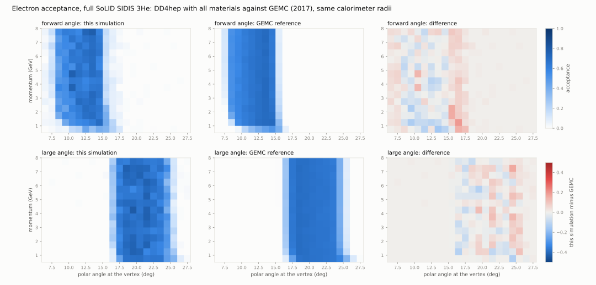

# Analysis of simulated events: particle tables and acceptance

The first layer between the simulation and the physics projections. It works on simulated hits with the Monte
Carlo truth, not on reconstructed quantities.

| step | tool | output |
|---|---|---|
| single particles, flat in momentum, polar angle, azimuth and along the target | `scripts/analysis/gun_events.py` | HepMC3 file |
| simulation | `ddsim` with `steering/solid_sim.py` | EDM4hep file |
| one row per generated particle with what it left in every detector | `scripts/analysis/particle_table.py` | `table.npz` |
| acceptance in (θ, p), with or without azimuthal segments, compared with GEMC | `scripts/analysis/acceptance.py` | maps, figure |

```
gun_events.py --pdg 11 -n 10000 --p 0.5:8 --theta 6:28 --z=-370:-330 -o e.hepmc
SOLID_GUN=0 SOLID_OPTICAL=0 ddsim --steeringFile $DETECTOR_PATH/steering/solid_sim.py --inputFiles e.hepmc -N 10000 \
        --outputFile sim.edm4hep.root
particle_table.py sim.edm4hep.root -o table.npz
acceptance.py table.npz --config full --plot acceptance.png --gemc acceptance_solid_SIDIS_He3_electron_1e7_201701_output_final.root
```

This is the method of the GEMC studies (`solid_gemc/analysis/acceptance`): particles flat in P and θ, even along
the target, and a map of the detected fraction. The maps of both simulations can therefore be compared bin by
bin, and physics events can be folded with them in the same way as before.

## The particle table

`python/solid_ana/table.py`. For every generator particle (generatorStatus 1):

- kinematics at the vertex: `pdg`, `p`, `theta`, `phi`, `vx`, `vy`, `vz` (GeV, rad, mm);
- for every tracker-type collection (GEM planes, scintillator pads, MRPC) and layer: whether the particle left a
  hit, the position and time of its first hit, and the azimuthal element of that hit (the GEM sector, the
  scintillator pad);
- for every calorimeter collection: the visible energy from the particle and all its descendants, the position
  of the cell with most of it, and the energy of the whole event.

Two properties of ddsim matter here. Showers that start inside the tracking region, which holds the large-angle
calorimeter, are stored as particles of their own: the table adds the energy of all descendants. And the hits of
secondaries that are not stored are booked on their stored ancestor: shower leakage can therefore add tracker
hits behind a calorimeter to a particle's row.

## What counts as detected

`python/solid_ana/accept.py`. A particle is detected in an arm when it left hits in enough GEM planes of the arm
and visible energy in the arm's calorimeter; a scintillator pad can be asked for as well.

| arm | GEM planes | default requirement |
|---|---|---|
| forward, SoLID-Lite | 5 forward planes | 4 planes, more than 5 MeV visible in the forward shower modules |
| large angle, SoLID-Lite | 4 large-angle planes | 3 planes, more than 5 MeV visible in the large-angle shower modules |
| forward, full SoLID | planes 2–6 of the six | the same |
| large angle, full SoLID | planes 1–4 | the same |

The shashlik modules show about 20 % of an electron's energy; 5 MeV visible is what a minimum-ionizing particle
leaves in 17 of the 194 layers. The requirement says that the particle reached the calorimeter, for full showers
and for the fast mode below alike: it gives acceptance, not efficiency. No Cherenkov is asked for, since optical
photons are off in these runs.

## Azimuthal segments as a selection

For SoLID-Lite the forward detectors may cover only segments of the azimuth
([lite_options.md](lite_options.md)). `acceptance.py --fa-segments 4x24` keeps a particle when the GEM sectors
it hit, its scintillator pad and its calorimeter cell lie inside the segments, which is what a detector built
only there would record. One simulation of a full-azimuth detector then serves every layout of segments. The
table stores detector elements, not the particle's azimuth at the vertex, because the solenoid turns positive
and negative particles in opposite directions on their way to the detectors.

This selection is exact as long as the removed elements were not needed for the particle to reach the kept ones.
The segmented geometry (`solid_SIDIS_He3_lite.xml`) exists to check that.

## Check against GEMC: electrons in the full SoLID

33 486 electrons, flat in 0.5–8 GeV and 6°–28° and along the 40 cm ³He cell, through `solid_SIDIS_He3` with all
materials and the v4c field map, against GEMC's map of 2017 (`solid_gemc/analysis/acceptance/result_SIDIS_He3/201701`:
10⁷ electrons, vacuum-and-absorber geometry, field CLEOv8, particles counted at virtual planes in front of the
calorimeters within 105–220 cm and 83–127 cm). With the same radii (`--ec-r-fa 105:220 --ec-r-la 83:127`):

| | forward arm | large-angle arm |
|---|---|---|
| edges at half of the plateau, this simulation | 8.2° and 15.2° | 16.8° and 24.9° |
| the same, GEMC | 8.2° and 15.1° | 16.7° and 24.7° |
| mean difference where both are above 50 % | −1.8 % | +0.1 % |
| scatter of the difference per bin (1° × 0.5 GeV, about 100 electrons) | 5.9 % | 5.2 % |

The edges agree within 0.2° and the plateau within 2 %; the scatter is the statistical error of this sample. The
forward arm loses about 2 % to the material that GEMC's simple geometry does not have.



Two things to know when comparing:

- **Where the radius is taken matters.** A cut on the calorimeter cell with most energy instead of on the position
  at the front moves the large-angle window down by 1.2°, because the shower maximum lies deeper and, for an
  inclined track, further out.
- **The calorimeters are larger than those radii.** Without the cut, with every module of the present layout, the
  arms span 7.2°–15.8° and 15.2°–25.9°. How much of the edge modules is usable is a question for the shower
  containment, not for the acceptance.

## Fast mode for acceptance runs

A shower in the shashlik modules takes most of the simulation time of an electron, nearly all of it in particles
of a few MeV crossing thin layers. An acceptance map only asks whether the particle arrived. With `SOLID_FAST=1`
the `SoLIDShowerStop` stacking action drops the secondaries that are born inside a calorimeter with less than
50 MeV (`SOLID_FAST_MIN_EKIN`); the energetic core of the shower still develops and marks the calorimeter.
Everything in front of the calorimeters is simulated in full.

| 150 electrons, 0.5–8 GeV, full SoLID | time per event | file size per event | detected forward / large angle |
|---|---|---|---|
| full showers | 0.34 s | 100 kB | 44 / 50 |
| production cut raised from 0.7 to 50 mm | 0.30 s | 90 kB | – |
| fast mode, secondaries below 20 MeV dropped | 0.13 s | 34 kB | 41 / 49 |
| fast mode, below 50 MeV (default) | 0.11 s | 27 kB | 43 / 50 |
| fast mode, below 100 MeV | 0.10 s | 24 kB | 39 / 44 |
| every secondary dropped | 0.08 s | 19 kB | 19 / 22 |

Two full-shower runs of the same electrons differ by up to three detected particles in an arm (electrons at the
edges), so the default reproduces the full result within that scatter. Dropping every secondary does not work:
the electron itself often ends in the lead radiator of the preshower. A fast-mode file has **no calorimeter
response**: no energy, no E/p, no trigger thresholds. The log says so in its last lines.

## Trapped particles

A low-energy electron born in a vacuum volume inside the solenoid field can be trapped between two regions of
stronger field. It loses no energy, every step completes, and Geant4's looper protection does not act: one such
event stopped a production job for good. `steering/solid_sim.py` therefore adds the `SoLIDTrackTimeLimit`
stepping action, which stops charged particles still being tracked 100 µs after the event
(`SOLID_MAX_TIME=<ns>`, 0 switches it off). The log reports each stopped track and their number.

## Test

ctest `analysis` (`scripts/analysis/test_analysis.py`): 80 electrons through `ddsim`; the table against the
generated kinematics; GEM sectors and scintillator pads against the hit positions; the segment selection against
the azimuth of the hits; the acceptance tool; the time limit.
