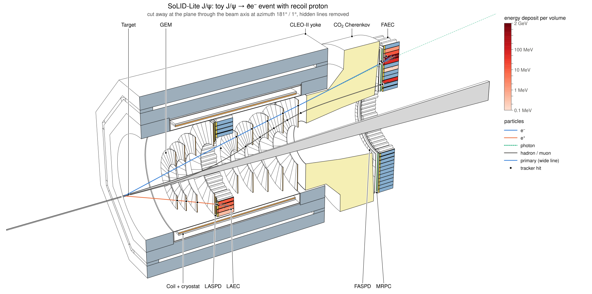
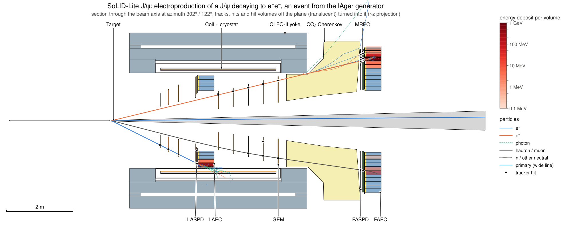
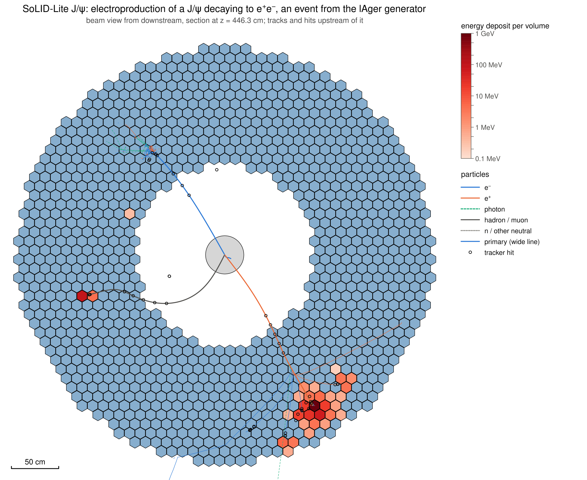
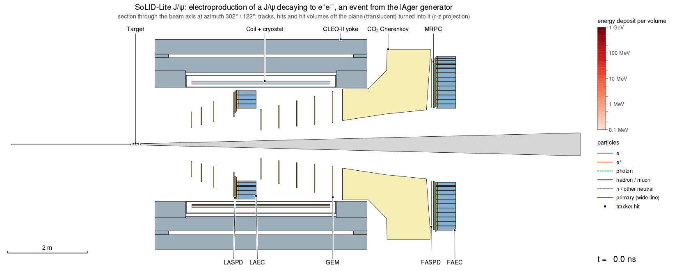
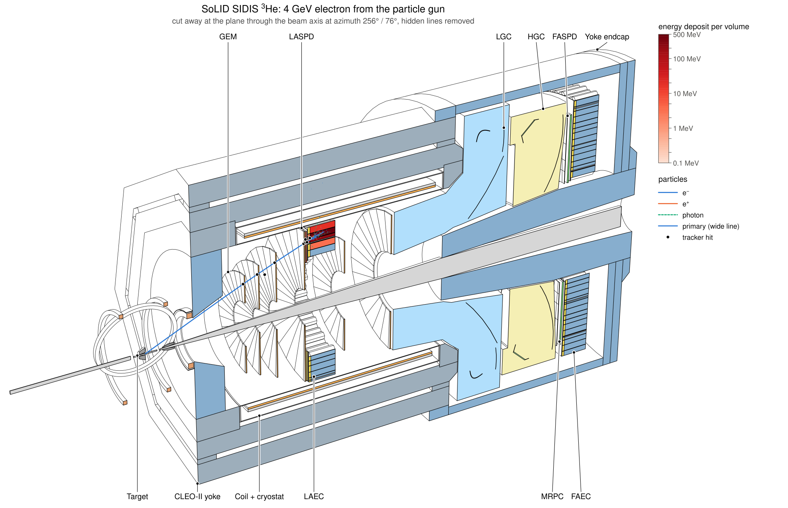

# Event displays and animations

Simulated events can be drawn on the [line drawings](visualization.md) of the detector: tracks coloured by
particle type, hit markers, and detector volumes coloured by the energy deposited in them. The same event can be
animated in simulation time. Nothing here uses a Geant4 vis driver or DAWNFILE.



```
ddsim + steering/solid_sim.py
 |- SOLID_SCENE=scene.npz --> geometry scene (polyhedra, volume IDs)                    scene.npz
 |- SOLID_TRAJ=traj.bin  ---> SoLIDTrajectoryRecorder: points with time and energy      traj.bin
 '- EDM4hep output: MCParticles, hits, calorimeter contributions                        sim.edm4hep.root
solid_evexport sim.edm4hep.root --scene scene.npz --traj traj.bin -o events/   -->      events/event_NNNNNN.npz
solid_evview events/ --scene scene.npz --views side,zoom,beam,cutaway [--animate]  -->  .svg .pdf .png .gif ...
```

| piece | where | needs |
|---|---|---|
| trajectory recorder `SoLIDTrajectoryRecorder` | `src/sim/TrajectoryRecorder.cpp`, in `libsolid_ddg4` | DDG4 |
| `solid_evexport`, `solid_evview` | `bin/`, package `python/solid_evdisplay` | numpy, uproot (export), pycairo (PNG, frames), Pillow (GIF) |
| renderer | package `python/solid_lineview` | numpy |

## Quick start

```bash
source <prefix>/bin/thissolid.sh solid_JPsi_lite

# everything in one command: 3 gun events, drawn together on the standard event views
make_solid_views -n 3 -o views                    # event_side, event_beam, event_cutaway
make_solid_views -n 1 -o views --animate          # one event, with an animation of the side view

# step by step
SOLID_SCENE=scene.npz SOLID_TRAJ=traj.bin SOLID_OPTICAL=0 \
    ddsim --steeringFile $DETECTOR_PATH/steering/solid_sim.py -N 10 --outputFile sim.edm4hep.root
solid_evexport sim.edm4hep.root --scene scene.npz --traj traj.bin -o events
solid_evview events --event 3 --views side,zoom,beam,cutaway --labels -o figures
solid_evview events --event 3 --animate side -o figures          # GIF and animated SVG
solid_evview events --overlay --views side,beam -o figures       # all events in one figure
```

## Trajectory recorder

`SOLID_TRAJ=FILE` (or `SOLID_TRAJ=1` for `solid_traj.bin`) in the environment of a ddsim job with
`steering/solid_sim.py` adds the DDG4 stepping action `SoLIDTrajectoryRecorder`. By hand:

```bash
ddsim ... --action.step '{"name": "SoLIDTrajectoryRecorder/TrajRec", "parameter": {"OutputFile": "traj.bin"}}'
```

- **What is recorded.** Every track except optical photons that is born with at least 5 MeV kinetic energy
  (`SOLID_TRAJ_MINEKIN`, property `MinEkin`), and every primary. A track gets a point at its start, after each
  step that takes it more than 20 mm from the last point or turns it by more than 0.04 rad
  (`SOLID_TRAJ_MAXDIST`, `SOLID_TRAJ_MAXANGLE`), and at its end. Each point has the position, the global time and
  the kinetic energy; each track its Geant4 track ID, parent ID and PDG code.
- **Independent of the truth record.** ddsim keeps few MCParticles for showers outside its tracker region (a
  forward-calorimeter shower leaves about ten, a large-angle one a thousand). The recorder does not use the
  particle handler and does not change it: the EDM4hep output is the same with and without `SOLID_TRAJ`.
- **Threads.** ddsim makes one recorder per worker thread. Each buffers its current event and appends it to the
  one file at the end of the event, under a lock. Events are therefore contiguous in the file but, with `-j N`,
  not in order; readers select by event number.
- **File format** (little endian), readable with numpy alone:

  ```python
  import numpy as np
  dtype = np.dtype([('event', '<i4'), ('track', '<i4'), ('parent', '<i4'), ('pdg', '<i4'),
                    ('x', '<f4'), ('y', '<f4'), ('z', '<f4'), ('t', '<f4'), ('ekin', '<f4'), ('flags', '<i4')])
  points = np.fromfile('traj.bin', dtype, offset=40)       # mm, ns, MeV
  ```

  The 40-byte header holds `SOLIDTRJ`, the version (1), the record size (40) and the three cuts as float32.
  `flags` bit 0 marks the first point of a track, bit 1 the last. `event` is the Geant4 event ID, which is the
  `EventHeader.eventNumber` of the EDM4hep file. `solid_evdisplay.trajfile` has the reader.

## Event files

`solid_evexport SIM.edm4hep.root --scene scene.npz [--traj traj.bin] [-o DIR]` writes `DIR/event_NNNNNN.npz`,
one numpy archive per event (schema 1; mm, ns, MeV; momenta and masses of MCParticles in GeV). It reads the
EDM4hep file with uproot and needs neither DD4hep nor ROOT.

| arrays | content |
|---|---|
| `meta` | JSON: configuration, geometry hash, event and run number, source files, recorder cuts, and per collection its name, kind (`tracker` or `calorimeter`), `photon` and `drawn` flags, number of hits and energy |
| `trk_id`, `trk_parent`, `trk_pdg`, `trk_ekin`, `trk_offset` | recorded tracks; track k owns the points `trk_offset[k]:trk_offset[k+1]` |
| `pt_pos`, `pt_time`, `pt_ekin` | trajectory points, in time order within a track |
| `hit_collection`, `hit_cellid`, `hit_node`, `hit_energy`, `hit_time`, `hit_pos`, `hit_particle` | every hit of every collection, with the scene node of its volume (`hit_node`) |
| `dep_hit`, `dep_time`, `dep_energy`, `dep_pdg` | calorimeter contributions, each pointing to its hit |
| `vol_node`, `vol_collection`, `vol_energy`, `vol_hits` | energy and number of hits per drawn volume |
| `mc_*` | the MCParticles ddsim kept (PDG, status, charge, mass, time, vertex, momentum, first parent) |

**Hit to volume.** Every drawn volume of the scene carries its readout, the volume ID bits fixed by the
placements down to it, and their mask. A hit belongs to the drawn volume of its readout with
`(cellID & mask) == id` that has the most mask bits. This is the rule of
[the scene](visualization.md#what-is-in-it), implemented once in `solid_evdisplay.hitmap` and used by
`solid_evexport` and `scripts/geometry/check_scene_hits.py`. The candidates are all drawn volumes that fix at
least one ID bit; restricting them to sensitive volumes (`--sensitive-only`) is possible but was not needed: no
hit had two candidates with the same number of bits in any configuration.

- A calorimeter hit lands on its module (shower or preshower), an SPD or MRPC hit on its pad or sector, a GEM
  hit on its chamber, a muon hit on its scintillator paddle or GEM module, a Cherenkov photon on its
  photocathode tile.
- `solid_evexport` checks on every run that each hit has exactly one such volume and that the energies per
  volume add up to the hit energies of each collection. Otherwise its exit status is 1.
- **Readouts without drawn volumes.** The muon observer planes of the DDVCS configurations
  (`MuonObserverHits`) are invisible virtual planes. Their hits are kept with `hit_node = -1`, the collection
  is flagged `drawn: false`, and they are neither drawn nor counted as errors.
- **Photon-counting readouts** (collections with `Cherenkov` in the name) are filled only when the simulation
  runs with optical physics (`SOLID_OPTICAL=1`, the default of the steering file; several times slower per
  event). Their hits are single photons: displays count them instead of summing energies.

Selection at export: `--event N` (repeatable), `--min-energy GEV`, `--select pair`, `--max-events K`; the same
options exist in `solid_evview`.

## Event views

`solid_evview EVENTS... [--scene scene.npz]` takes event files or directories of them. The scene defaults to
the one the events were exported with; the geometry hashes must agree.

| view | what it shows |
|---|---|
| `side` | section through the beam axis in the event plane. Tracks, hits and hit volumes that the plane misses are turned about the beam axis into the plane (r-z projection); such volumes are drawn translucent. |
| `zoom` | the same, 1.2 m high (`--zoom-half`), around the volume with the largest energy deposit |
| `beam` | beam-eye section 2 cm behind the front face of that volume (`--zsec` sets z), seen from downstream; tracks and hits upstream of the section, hits as rings |
| `cutaway` | 3-D hidden-line drawing cut at the event plane, tracks hidden where they pass behind solids |

- **Event plane.** The plane through the beam axis that the energy deposits lie closest to (the principal axis
  of their x-y positions). `--phi DEG` sets it by hand.
- **Tracks.** e⁻ blue, e⁺ orange, photons green dashed, hadrons and muons dark grey, other neutrals grey
  dotted; primaries 2.6 times wider. Secondaries are drawn from 5 MeV (charged, `--emin`), 20 MeV (photons,
  `--emin-gamma`) and 50 MeV (other neutrals, `--emin-neutral`) kinetic energy at birth.
- **Energy.** Every drawn volume with hits is coloured by its energy deposit on a log scale in one red ramp,
  from 0.1 MeV (`--emin-cal`) to the largest deposit, with a colour bar. Volumes below the minimum keep their
  colour (GEM and MRPC gas usually; raise or lower `--emin-cal` as needed).
- **Hits.** Black dots at tracker-type hits (GEM, SPD, MRPC, muon chambers). A sensor of a photon-counting
  readout that saw photons is violet and gets a violet dot, because the photocathode tiles are too thin to see.
- **Labels.** `--labels` adds the subsystem callouts of `solid_lineview --labels solid` to the side and cutaway
  views. `--title TEXT` replaces the default title `<config>, event N`.
- **Selection.** `--event N` (repeatable), `--min-energy GEV` (calorimeter deposit), `--max-events K`, and
  `--select pair`: the generator particles hold an e⁺ and an e⁻ that both leave at least 3 GEM hits
  (`--min-tracker-hits`); `pair-mu` is the same for muons.
- **Overlay.** `--overlay` draws all selected events in one figure, with the energies per volume summed. The
  plane is then x = 0 unless `--phi` is given.
- **Output.** `--formats svg,png` (default), also `pdf` and `eps`; names from
  `--name '{config}_event{event}_{view}'`.





## Animation

`solid_evview ... --animate [VIEWS]` (default `side`) animates views with a fixed camera: tracks grow with the
simulation time, hits appear, and volumes fill with energy as it is deposited (calorimeter contributions carry
their times). The time runs from 0 to the moment 99 % of the energy is deposited and the primaries have ended
(at most 50 ns), plus 2 ns (`--t-end`). The last frame is the static figure, held for 2 s (`--hold`).



| format | how | available |
|---|---|---|
| GIF | Pillow, one global palette, unchanged pixels transparent | always (eic_xl has Pillow) |
| animated SVG | one file with SMIL animation; plays in browsers | always, no encoder needed |
| WebP | Pillow, lossless | only if Pillow was built with WebP; not the case in eic_xl 26.10 or solid_xl, so untested |
| MP4 (H.264, yuv420p), WebM (VP9) | frames piped to ffmpeg | only if `$SOLID_FFMPEG` or `ffmpeg` on `PATH` exists; eic_xl has none, solid_xl has |

`--anim-formats gif,svg,webp,mp4` is the default. A format without an encoder is skipped with one line of
explanation, and the exit status stays 0. Other options: `--frames 120`, `--fps 12`, `--frame-scale 0.6`
(frame size relative to the PNG), `--gif-max-kb 1000` (the GIF is rendered again at a smaller scale if it comes
out larger).

In the animated SVG, dashed tracks (photons, neutrals) appear at their start time instead of growing, volume
colours change in at most 12 steps, and the clock steps by 1 ns.

## make_solid_views

`make_solid_views -n EVENTS` runs the whole chain with the default particle gun and draws the events (several
events as one overlay):

| view | drawing |
|---|---|
| `event_side`, `event_zoom`, `event_beam`, `event_cutaway` | the four views above (`-n` default: side, beam, cutaway) |
| `section_yz`, `section_xz`, `cutaway`, `beam_<z>` | the standard views with the events on top: side view at x = 0 or y = 0, cutaway at x = 0, beam section at z |
| `lines_yz`, `overview`, `field_yz` | as without events |

`--animate` adds the animation of `event_side`. `--keep` keeps the work directory with the simulation output
and the event files. `--source dawnfile -n EVENTS` is the old route: the Geant4 DAWNFILE driver records
trajectories and hit markers without times or energies, drawn in the colours Geant4 gives them.

## Measurements

eic_xl 26.10.0 (DD4hep 1.38, Geant4 11.4.1), `solid_JPsi_lite`, `SOLID_OPTICAL=0`, a 4-core desktop that other
jobs were using at the time; times are therefore upper limits.

**Recorder cost.** Identical events (same seed) with and without `SOLID_TRAJ`, 100 events per run, three
pairs of runs each; the time is DDSim's "Processing and Init".

| sample | without recorder [s] | with recorder [s] | difference per pair |
|---|---|---|---|
| 4 GeV e⁻ gun | 33.5, 31.4, 28.0 | 34.5, 31.5, 28.4 | +3.1 %, +0.2 %, +1.5 % |
| toy J/ψ → e⁺e⁻ (with recoil proton) | 73.9, 74.2, 72.2 | 69.0, 69.6, 80.3 | −6.7 %, −6.1 %, +11.2 % |

The gun sample puts the cost at about 1.5 %. The J/ψ pairs scatter by more than the 5 % target in both
directions (the machine was shared), so they only show that the cost is not larger than the run-to-run
spread. The EDM4hep files have the same size with and without the recorder.

**Sizes** (120 events each, 5 MeV cut):

| sample | trajectory file | points per event | event.npz |
|---|---|---|---|
| 4 GeV e⁻ gun | 0.41 MB per event | 10 250 | 0.24 MB per event |
| toy J/ψ → e⁺e⁻ | 1.00 MB per event | 24 890 | 0.61 MB per event |

`solid_evexport` took 4.2 s and 5.9 s for the 120 events.

**Hit mapping.** Hits without exactly one most specific drawn volume, and ties:

| sample | hits | no volume | ties |
|---|---|---|---|
| `solid_JPsi_lite`, 120 gun events | 38 524 | 0 | 0 |
| `solid_JPsi_lite`, 120 toy J/ψ events (104 pass `--select pair`) | 99 599 | 0 | 0 |
| `solid_JPsi_lite`, 8 gun events at 10° to 12° with optical physics (143 Cherenkov photon hits) | 3 647 | 0 | 0 |
| `solid_DDVCS`, 4 muon-gun events at 6 GeV (14 muon scintillator and GEM hits) | 828 + 11 observer hits | 0 | 0 |
| `solid_DDVCS_lite`, 4 muon-gun events at 6 GeV | 267 + 4 observer hits | 0 | 0 |

**All configurations**, 4 gun events each (default gun of the steering file), four views as SVG and PNG:

| configuration | hits | no volume / ties | trajectory file per event | views, per event |
|---|---|---|---|---|
| `solid_SIDIS_He3` | 1443 | 0 / 0 | 0.47 MB | 5.2 s |
| `solid_SIDIS_NH3` | 1720 | 0 / 0 | 0.52 MB | 5.2 s |
| `solid_PVDIS` | 416 | 0 / 0 | 0.22 MB | 5.7 s (two events without a deposit: side and cutaway only) |
| `solid_JPsi` | 1523 | 0 / 0 | 0.51 MB | 5.8 s |
| `solid_DDVCS` | 1767 | 0 / 0 | 0.50 MB | 6.0 s |
| `solid_JPsi_lite` | 1122 | 0 / 0 | 0.39 MB | 3.6 s |
| `solid_DDVCS_lite` | 1376 + 7 observer hits | 0 / 0 | 0.41 MB | 3.6 s |

The times are wall-clock for a batch of four events; a single event adds about 1.5 s of start-up (imports and
reading the scene), which gave 7.1 s for one `solid_JPsi_lite` event.

**Threads.** With `--random.enableEventSeed`, 8 events from `-j 1` and `-j 3` (and 6 events from `-j 2`) gave
identical event files: 91 851 trajectory points and 2 599 hits, every array equal. The figures are made from
these files alone.

**Animation**, 120 frames at scale 0.6, one `solid_JPsi_lite` gun event:

| view | frame size | frames | GIF | animated SVG |
|---|---|---|---|---|
| side | 1714 × 626 | 5.2 s (8.6 s under heavier load) | 290 kB | 0.40 MB |
| beam | 1174 × 944 | 3.5 s | 242 kB | 0.20 MB |
| cutaway | 1714 × 810 | 6.1 s | 392 kB | 0.51 MB |

Writing the GIF takes another 0.4 to 0.7 s. The toy J/ψ event of the figures above (759 drawn tracks) gave a
300 kB GIF and a 0.9 MB animated SVG. With ffmpeg 7.1 (solid_xl), 60 frames of the side view became a 67 kB MP4
(H.264, yuv420p) and a 49 kB WebM (VP9). After the GIF palette, the last frame differs from the static figure
drawn at the same scale by 0.1 grey levels of 255 on average (smoke test).

## Checks

| check | command | what it verifies | time |
|---|---|---|---|
| smoke test | `ctest -R event_display` in the build directory (runs `scripts/event_display/test_event_display.py`) | 1 gun event: recorder file, export (unique volumes, energy sums), side and beam views as SVG and PNG, an 8-frame animation as GIF and animated SVG, last GIF frame against the static figure, MP4 skipped cleanly without ffmpeg | 20 to 30 s |
| threads | `scripts/event_display/check_traj_threads.py -c solid_JPsi_lite -n 6 -j 2` | a `-j 1` and a `-j 2` run with `--random.enableEventSeed` export to identical event files (all arrays) | 35 s |
| hit mapping | `scripts/geometry/check_scene_hits.py -c CONFIG -n 3`, or the table `solid_evexport` prints | every hit has exactly one most specific drawn volume | 20 s |

None of them is in the CI workflow yet. The smoke test needs ddsim, numpy, uproot, pycairo and Pillow.

## Figures in this document

The files `docs/images/event_*` were made with the installed tools from the lAger J/ψ sample of
[Generators](#generators) (event 102 of the 500 events of `lager -r 1`, ddsim seed 2026), from the same event
simulated again together with 10 000 beam electrons, and from a `solid_SIDIS_He3` gun event:

```bash
solid_evexport sim.edm4hep.root --scene scene.npz --traj traj.bin -o events --select pair
solid_evview events -e 102 --views side,beam,cutaway --labels --formats svg --name 'event_{config}_{view}' \
    --title 'SoLID-Lite J/ψ: electroproduction of a J/ψ decaying to e⁺e⁻, an event from the lAger generator' \
    --animate side --anim-formats gif -o docs/images
solid_evview events_background --views side --labels --formats png --size 2000x1250 \
    --name 'event_{config}_background_{view}' -o docs/images \
    --title 'SoLID-Lite J/ψ: the same lAger event with 10 000 beam electrons on the target (0.5 ns at 3 µA)'
solid_evview events_he3 -e 0 --views cutaway --labels --formats svg --name 'event_{config}_{view}' \
    --title 'SoLID SIDIS ³He: 4 GeV electron from the particle gun' -o docs/images
```

In the event of the figures the positron (6.0 GeV, 14°) goes through five GEM planes into the forward
calorimeter and the electron (3.4 GeV, 27°) through three into the large-angle calorimeter; the recoil proton
(1.0 GeV) reaches the forward calorimeter, and the scattered beam electron (1.2 GeV, 0.7°) leaves through the
exit beam pipe.



## Toy J/psi events

`scripts/event_display/toy_jpsi.py -n 100 -o jpsi_toy.hepmc [--lepton mu] [--lepton-theta 8 26]` writes HepMC3
events of γ p → J/ψ p → l⁺l⁻ p for displays and performance tests:

```bash
SOLID_GUN=0 SOLID_SCENE=scene.npz SOLID_TRAJ=traj.bin SOLID_OPTICAL=0 \
    ddsim --steeringFile $DETECTOR_PATH/steering/solid_sim.py --inputFiles jpsi_toy.hepmc -N 100 --outputFile sim.edm4hep.root
```

**It is a toy, not a physics generator.** The photon energy follows 1/E between the J/ψ threshold and the beam
energy, the momentum transfer exp(1.5 t / GeV²), the decay 1 + cos²θ in the helicity frame, and the vertex is
uniform along a 15 cm target. There is no cross section, no scattered electron, no radiative correction and no
background, and all weights are 1. Do not use it for acceptance, rate or resolution studies. No J/ψ generator
is installed in eic_xl (Pythia 8 is there as a C++ library without Python bindings and is not a practical
source of exclusive J/ψ at 11 GeV).

## Limits

- **Cutaway.** Only volumes that the cut plane goes through are coloured by energy; hit volumes behind the
  plane keep their colour. Hit markers and the dots of Cherenkov sensors are not hidden by geometry in front
  of them. Tracks are hidden correctly.
- **r-z projection.** In the side views a track is folded into one half plane as a whole; a track that crosses
  the beam axis region shows a kink there.
- **Beam view.** One section plane per figure: with showers in both calorimeters only the one with the largest
  deposit is cut, unless `--zsec` is given.
- **Events without a deposit** in a drawn volume (a particle stopped in the PVDIS baffles, for example) have no
  zoom or beam view; `solid_evview` says so and draws the other views.
- **Energy after the animated time span** (slow neutrons) appears only in the last frame.
- **Photon-counting readouts** were exercised on one `solid_JPsi_lite` event with 143 photon hits. The light
  and heavy gas Cherenkovs of the full configurations use the same code but were not run with optical physics
  here.
- **Trajectory file size** grows with the shower energy. Hadronic or background-mixed events were not measured.
- **MCParticles.** Event selection by `--select pair` uses the tracker-hit links to the generator particles,
  which ddsim always keeps. Nothing else depends on the truth record.
- **WebP** output is untested (no Pillow with WebP support at hand). **MP4 and WebM** were tested with ffmpeg
  7.1 in solid_xl (stream properties checked with ffprobe); playing them in PowerPoint or Keynote was not tried.
- **PNG text.** Inside eic_xl the only Helvetica is a bitmap font, so text in the SVG or PDF is crisper than in
  the PNG, as for the geometry drawings.
