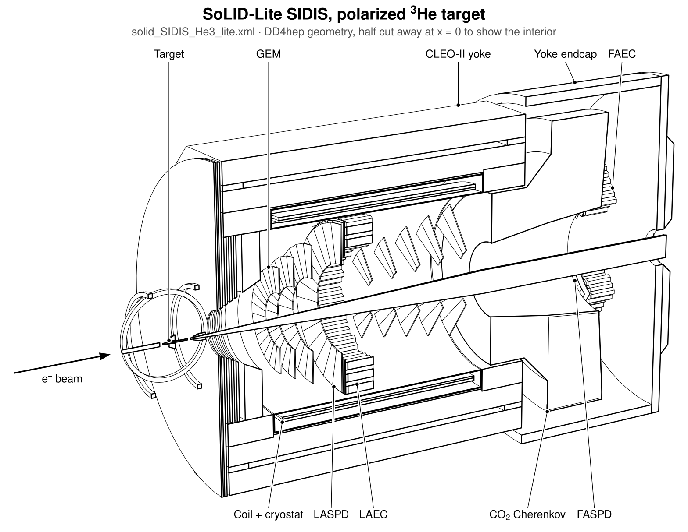
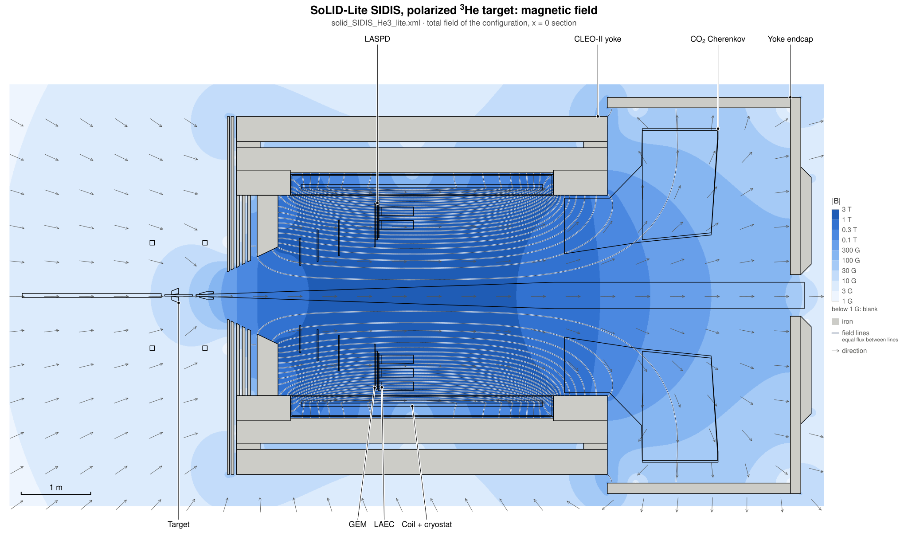

# SoLID-Lite options

SoLID-Lite is not one design. Its purpose is lower cost, and the iron, the azimuthal coverage and the detector
types are open choices that are being weighed against the physics. The geometry therefore offers the choices
separately, and `bin/solid_lite_config` writes the top-level file for one set of them.



## Committed configurations

| file | what it is | follows |
|---|---|---|
| `solid_JPsi_lite.xml`, `solid_DDVCS_lite.xml` | stage 1, CLEO-II iron as built; forward detectors over the full azimuth except the Cherenkov (8 of 30 sectors); forward MRPC | the GEMC set-ups `solid_JPsi_LH2_lite_full`, `solid_JPsi_DDVCS_LH2_lite_full`, to stay comparable with them |
| `solid_SIDIS_He3_lite.xml` | stage 2, iron with front piece and endcap; large angle full, forward angle in 4 segments of 24°; one CO₂ Cherenkov; no MRPC | the October 2026 workshop talks ("4seg24degFA+LA"); there is no GEMC set-up |

## Writing another option

```
solid_lite_config --experiment SIDIS_He3                        # the committed solid_SIDIS_He3_lite.xml
solid_lite_config --experiment SIDIS_He3 --fa full -o he3_fullFA.xml
solid_lite_config --experiment SIDIS_He3 --iron stage1 -o he3_stage1.xml
solid_lite_config --experiment JPsi --fa none -o jpsi_LAonly.xml
ddsim --compactFile he3_fullFA.xml --steeringFile $DETECTOR_PATH/steering/solid_sim.py ...
```

| option | values | effect |
|---|---|---|
| `--experiment` | `SIDIS_He3`, `JPsi`, `DDVCS` | target, beam line, target position; `DDVCS` adds the forward muon detector |
| `--iron` | `stage1`, `stage2` | magnet iron and its field map (default: `stage2` for `SIDIS_He3`, else `stage1`) |
| `--fa` | `4seg24`, `full`, `none` | forward-angle GEM planes, Cherenkov, calorimeter and scintillator pads: four 24° segments, all azimuth, or absent |
| `--la` | `full`, `none` | large-angle GEM planes, calorimeter and scintillator |
| `--mrpc` | `off`, `on` | forward MRPC (off: time of flight from the scintillator pads) |

A written file needs only `DETECTOR_PATH` (from `thissolid.sh`) to load. ctest `lite_config` checks that the tool
reproduces the committed file, that every option loads without overlap and that the segments reach every forward
detector (306 of 1145 calorimeter modules, 64 of 240 pads, 8 of 30 GEM and Cherenkov sectors).

**Full azimuth for acceptance studies.** `--fa full` builds the SoLID-Lite detector types over the whole azimuth.
One simulation of it serves every choice of segments, applied afterwards as a selection on the hits, as long as a
removed part does not sit in front of a kept one. The segmented geometry is for the check of that, for rates and
for drawings.

## How the segments are set

The four segments are those of the CO₂ Cherenkov in GEMC (`hgc_moved_ext`, variation `4seg2sec`): pairs of 12°
sectors centred at φ = 42°, 138°, 222° and 318°. They form two opposite pairs, which the SIDIS asymmetries need.
The talks draw the segments at 0°, 90°, 180° and 270°; whole 12° sectors cannot give that.

`compact/configs/lite_FA_4seg24.xml` sets the constants of all forward detectors together and is included in the
top-level `<define>` before any detector fragment (the plugins take the first definition of a constant):

| detector | constant | default in the fragment |
|---|---|---|
| forward GEM planes | `GEMFA_Sectors` = `4,5,11,12,19,20,26,27` | `1-30` |
| CO₂ Cherenkov | `LiteCherenkov_Sectors` = `4 5 11 12 19 20 26 27` | the same; `all` for full azimuth |
| forward calorimeter | `FAEC_PhiMask_enable` = 1 (modules with their centre in a segment) | 0 |
| forward scintillator pads | `FASPD_UsePhiMask` = 1 | 0 |
| forward MRPC | `FAMRPC_UsePhiMask` = 1 | 0 |

Segment number, width and centres are constants of each fragment (`FAEC_PhiMask_*`, `FASPD_PhiMask_*`, ...), and
the large-angle detectors have the same switches (`GEMLA_Sectors`, `LAEC_PhiMask_*`, `LASPD_*`), off by default.

## What is provisional or missing

- **Stage-2 iron and its field.** The front piece, shields and endcap are those of one two-dimensional POISSON
  model shown in October 2026; real shapes, supports and the attachment to the yoke are not defined. The field
  map is computed from that model. It leaves about 20 G at the ³He target (see the field drawing below), far
  above what the polarized target tolerates: the iron is not final.
- **³He target collimators** are the 2022 design, made for the full SoLID nose opening.
- **Calorimeter.** The options use the SoLID shashlik modules. The re-used sPHENIX calorimeter considered for
  SoLID-Lite is not modelled.
- **Cherenkov.** CO₂ in the heavy-gas tank as in GEMC; the 1 m extension and the higher-pressure option of the
  talks are not built.
- **Segments other than 4 × 24°** (two or eight forward segments, large-angle segments) are possible through the
  constants above but have no preset yet.


