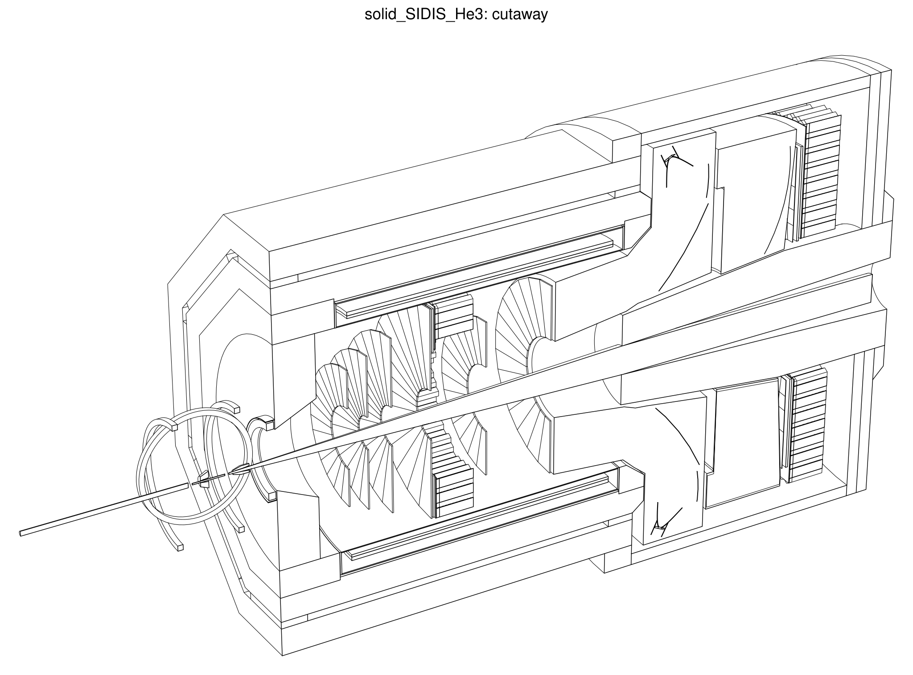

# Line-view drawings of the SoLID geometry

The SoLID collaboration has long used clean black-and-white line drawings made with DAWN (Fukui Renderer):
Geant4 writes a DAWNFILE `.prim` scene, `dawncut` cuts it, and `dawn` renders it to EPS. DAWN and dawncut date from
the X11/Tcl era and are hard to install and script. This repository replaces the last two steps with
**`bin/solid_lineview`**, a single Python program (numpy; pycairo or matplotlib only for PNG) that reads the same
`.prim` files and writes SVG, PDF, EPS and PNG.

```
ddsim (DAWNFILE driver) --> g4_0000.prim --> solid_lineview --> .svg / .pdf / .eps / .png
```

## Quick start

```bash
source <prefix>/bin/thissolid.sh solid_JPsi_lite
make_solid_views -o views                       # section_yz, section_xz, cutaway, lines_yz
make_solid_views -o views -n 5                  # same, with 5 events of trajectories
make_solid_views -o views --views beam_440,beam_-40      # beam-eye sections at z = 440 and -40 cm
make_solid_views -o views --views overview      # labelled detector overview (see below)
```

To make a `.prim` file by hand:

```bash
cat > dawnfile.mac <<EOF
/vis/open DAWNFILE
/vis/viewer/set/lineSegmentsPerCircle 72
/vis/drawVolume
/vis/viewer/flush
EOF
echo exit | G4DAWNFILE_VIEWER=true ddsim --compactFile $DETECTOR_PATH/$DETECTOR_CONFIG.xml \
     --runType vis --macroFile dawnfile.mac
```

`G4DAWNFILE_VIEWER=true` stops Geant4 from starting the legacy `dawn` program after the file is written. The `exit`
on stdin ends the interactive session that `--runType vis` opens.

## Overview figures

The `overview` view of `make_solid_views` (not in the default list) draws the labelled figure shown in the
[README](../README.md). It is the hidden-line cutaway seen from a lower camera, with the beam line trimmed to the
length of the detector, an e⁻ beam arrow, one callout label per subsystem, and the configuration's name as the title.
The figures in `docs/images/overview_<config>.svg` were made in `containers/solid-shell` with

```bash
for c in solid_SIDIS_He3 solid_SIDIS_NH3 solid_PVDIS solid_JPsi solid_DDVCS solid_JPsi_lite solid_DDVCS_lite; do
    make_solid_views -c $c --views overview --formats svg --name '{view}_{config}' -o docs/images
done
```

The `solid_lineview` options behind it also work on their own:

| option | effect |
|---|---|
| `--labels solid` | built-in label set: target, yoke, yoke endcap, coil, baffles, GEM, Cherenkovs, ECal, SPD, MRPC, muon system (only those present and visible are drawn) |
| `--label 'REGEX=Text'` | label the volumes whose physical-volume name matches REGEX; replaces the preset entry with the same REGEX, an empty text removes it |
| `--label-rows`, `--label-size`, `--label-color`, `--label-lw`, `--label-dot` | label layout and style |
| `--trim 'Beamline=auto'` | cut only the matching volumes, to the z range of everything else (`--trim-margin`) or to explicit limits such as `z<5m` |
| `--beam-arrow [TEXT]` | arrow on the beam axis upstream of the drawing |
| `--view-dir DX DY DZ` | camera direction; the overview uses `-0.80 0.30 -0.52` |
| `--title-bold`, `--title-size`, `--subtitle` | title style and a grey second line |

Each label's dot sits on a line of its subsystem that is actually drawn. The texts go in a row above or below the
drawing, in the order of their dots, so leaders do not cross. Sub- and superscripts (³He, NH₃, CO₂, e⁻) are typeset in
SVG, PDF, EPS and PNG, and ψ is drawn as a glyph outline, so the SVG does not depend on the viewer's fonts for it.
Text is laid out with Helvetica metrics. Inside eic_xl the only Helvetica is an X11 bitmap font, so the SVG or PDF
gives crisper text than the PNG there.

## Gallery (generated by `make_solid_views`, November 2026 geometry)

| configuration | labelled overview (`overview`) | x = 0 section (`section_yz`) | cutaway, hidden lines removed (`cutaway`) |
|---|---|---|---|
| SIDIS 3He | [svg](images/overview_solid_SIDIS_He3.svg) | [svg](images/solid_SIDIS_He3_section_yz.svg) | [svg](images/solid_SIDIS_He3_cutaway.svg) |
| SIDIS NH3 | [svg](images/overview_solid_SIDIS_NH3.svg) | [svg](images/solid_SIDIS_NH3_section_yz.svg) | |
| PVDIS | [svg](images/overview_solid_PVDIS.svg) | [svg](images/solid_PVDIS_section_yz.svg) | [svg](images/solid_PVDIS_cutaway.svg) |
| J/psi | [svg](images/overview_solid_JPsi.svg) | [svg](images/solid_JPsi_section_yz.svg) | |
| DDVCS | [svg](images/overview_solid_DDVCS.svg) | [svg](images/solid_DDVCS_section_yz.svg) | |
| SoLID-Lite J/psi | [svg](images/overview_solid_JPsi_lite.svg) | [svg](images/solid_JPsi_lite_section_yz.svg) | [svg](images/solid_JPsi_lite_cutaway.svg) |
| SoLID-Lite DDVCS | [svg](images/overview_solid_DDVCS_lite.svg) | [svg](images/solid_DDVCS_lite_section_yz.svg) | [svg](images/solid_DDVCS_lite_cutaway.svg) |



## Rendering modes

| mode | what it draws | DAWN equivalent |
|---|---|---|
| `section` | exact 2-D cut of every solid by a plane (`--section x=0`, `--section z=440cm`), closed outlines, optional fill with the vis colors | top view of a thin dawncut slab |
| `hlr` | 3-D hidden-line removal: crease, boundary and silhouette edges, visibility from a high-resolution depth buffer, output as vector polylines | draw mode 2/4 |
| `wireframe` | all feature edges, no hidden-line removal | draw mode 1 |
| `surface` | flat-shaded hidden-surface image plus visible edges | draw mode 3 |

Half-space cuts (`--dawncut a b c d`, same convention as dawncut; any number of them) work in every mode.
Cut faces are capped. Camera presets are `--view side|top|beam|iso`. DAWN camera angles are available with
`--dawn-angles POLAR AZIMUTH` or `--dawn-history .DAWN_1.history`, and perspective with `--perspective DIST`. Use
`--include/--exclude REGEX` to select volumes by physical-volume name. Trajectories and hits from the `.prim`
file are drawn on top (`--no-traj`, `--no-hits` to suppress them). Other options: `--scale-bar`, `--title`,
`--color-lines`, `--fill`. Run `solid_lineview --help` for the full list.

Performance: one view of a full SoLID `.prim` takes 2–10 s, about half of it spent parsing; the labelled overview
is the slowest. Writing the `.prim` with ddsim takes about 15 s more.

## Alternatives that were evaluated

* **dawn/dawncut** are still shipped in `eic_xl` (`/opt/local/bin/dawn`, `dawncut`), so the old pipeline keeps
  working. It needs an X11/Tcl session and ps2pdf/gs post-processing.
* **dusk/duskcut** (eic_xl, 2026) is EIC's OpenCascade-based DAWN replacement. It works on STEP files from
  `npdet_to_step`. It was tested in eic_xl 26.10 on the SoLID geometry of this repository, before and after the
  November 2026 rebuild. `npdet_to_step` dropped the octagonal (polyhedra) yoke barrel and the old boolean
  Cherenkov tanks, and left spike artifacts on some booleans. `dusk` 0.1.0 does not fit the scene to the page;
  `--mag` has to be tuned by hand. Worth revisiting as it matures, since it gives exact (B-rep) hidden lines.
  `solid_lineview` instead uses the polyhedra Geant4 builds for its own visualization drivers, so it supports
  every solid Geant4 can draw.
* **Geant4 TSG/OpenGL + gl2ps** writes vector output, but with sorted polygons rather than true hidden-line
  removal.
