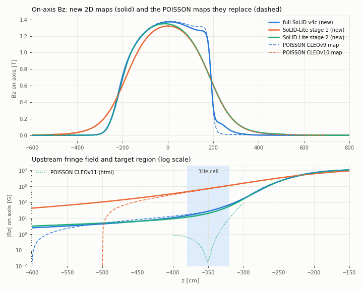

<!-- SPDX-License-Identifier: LGPL-3.0-or-later -->
# magnet_field: SoLID solenoid field maps from the DD4hep geometry

`magnet_field/` replaces the Poisson Superfish chain (AUTOMESH, POISSON, SF7) for the SoLID CLEO-II solenoid. It
extracts a 2D axisymmetric (r-z) model of the magnet from the DD4hep geometry, solves the nonlinear magnetostatic
problem with finite elements (package `rzfield`), and writes GEMC field maps (rows `R Z Br Bz`, cm and gauss) that
`SoLID_FieldMapB` reads.

| map (R 0..500 cm, Z -600..800 cm, 1 cm, 30.4 MB) | magnet compact | field fragment | replaces |
|---|---|---|---|
| `solenoid_SoLID_v4c_2D.dat` | `magnet/solenoid_v4.xml`: full SoLID, yoke v4c | `fields/field_SoLID_v4c_2D.xml` | `field_CLEOv9.xml` (full-SoLID configurations) |
| `solenoid_SoLIDlite_stage1_2D.dat` | `magnet/solenoid_nomod.xml`: SoLID-Lite stage 1 | `fields/field_SoLIDlite_stage1_2D.xml` | optional; `field_CLEOv10.xml` stays the SoLID-Lite default |
| `solenoid_SoLIDlite_stage2_2D.dat` | `magnet/solenoid_lite_sidis.xml`: stage 2, provisional | `fields/field_SoLIDlite_stage2_2D.xml` | `field_CLEOv10.xml` (stopgap; stage-2 magnet test) |

The fragments download the maps once from the `fieldmaps-v1` release of solid_dd4hep into
`${DETECTOR_PATH}/fieldmaps/` and check their sha256 ([Publishing the maps](#publishing-the-maps));
`make_maps.sh` (6 min, below) regenerates them. Their z range covers the DDVCS muon system (absorbers at
z 620-748 cm and r < 394 cm, last detector plane at z 758 cm).

## Quick start

```bash
# in a solid_dd4hep checkout with an install (containers/install.sh --build) and apptainer or singularity
magnet_field/make_maps.sh -f install/share/solid/fieldmaps          # all three models; or name them: v4c stage1 stage2
```

* Python: the solver needs python3 with numpy, scipy and gmsh (`requirements.txt`). In a virtual environment:
  ```bash
  python3 -m venv venv && venv/bin/python -m pip install -r magnet_field/requirements.txt
  magnet_field/make_maps.sh --python venv/bin/python -f install/share/solid/fieldmaps
  ```
  On Debian and Ubuntu `python3 -m venv` needs the `python3-venv` package; without it, it stops with "ensurepip is
  not available". Without root, `python3 -m venv --without-pip --system-site-packages venv` works with the system
  pip. Such a venv also sees the packages in `~/.local`, and those take precedence over the system ones, so set
  `PYTHONNOUSERSITE=1` for the `pip install` and for the runs: only the venv and the system packages are then
  used. (Ubuntu 22.04: numpy 1.21.5, scipy 1.8.0 and matplotlib 3.5.1 from the system, gmsh 4.15.2 from PyPI; the
  tests pass and the CLEOv10 validation reproduces.)

* For each model, `extract_rz_model.py` writes the deck in the eic_xl container (through `containers/solid-shell`,
  about 20 s), then `solve_rz.py` solves it on the host (gmsh is not in the container; 70-110 s, up to 2 GB and 3
  threads). The three models took 344 s on a 4-core host. Results go to `magnet_field/work/maps/` (`decks/`,
  `solutions/`, `logs/` and the maps). `-f DIR` copies the maps to DIR.
* `-n` skips the extraction and solves the committed decks in `models/` (no container needed). It first checks
  that the checkout's files are still those the decks were extracted from (`extract_rz_model.py check`, sha256
  recorded in `models/<deck>.json`; comments, `<info>` titles and the field include of the test top-level do not
  count). If a magnet file (`compact/magnet/`, `test/test_magnet_*`) has changed, it stops (run without `-n`, or
  `--allow-stale`); other changed files, including the magnet plugin source, only give a warning. See
  `make_maps.sh -h` for `--python`, `-p PREFIX`, `-i IMAGE`, `-j N` and `--air-side`. The gmsh wheel needs a few
  X11 client libraries (libGLU, libXrender, libXcursor, libXft, libXinerama).
* After the extraction the script reports whether each deck still has the regions of the committed one. If the
  DD4hep magnet has changed, review the new deck, copy it and its `.json` sidecar to `models/` (the sidecar is what
  `-n` checks) and update the reference values in the field fragment.
* To use a map, include its fragment in the top-level file instead of `field_CLEOv9.xml` or `field_CLEOv10.xml`.
  If the map is missing, `SoLID_FieldMapB` stops with the command that generates it (the fragment's `hint`
  attribute, src/FieldMapB.cpp).

## Files

```
make_maps.sh          one command: DD4hep geometry -> decks -> solutions -> maps
extract_rz_model.py   DD4hep magnet -> POISSON-style deck (.am) + JSON sidecar; also compare, plot-fraction and
                      check (are the decks still those of the checkout's magnet files)
solve_rz.py           deck -> mesh -> nonlinear solve -> solution (.npz) [+ GEMC map]       (needs gmsh)
write_map.py          solution -> GEMC map on any grid                                       (numpy and scipy)
eval_field.py         solution -> B(r, z) at points or on the axis                           (numpy and scipy)
validate_poisson.py   solution vs a POISSON map or another solution: reference points, regions, plots
compare_references.py new maps vs the POISSON references; rebuilds the CLEOv11 deck from the Stage 1/2 html
models/               the three decks, their JSON sidecars, cleo2_coils.json (coil currents), README.md (details);
                      equal_area/ (the same magnets at equal-area radii, for sensitivity studies)
rzfield/              solver: amdeck (deck reader), bh (B-H curves, data/bh_1010_poisson.txt), mesh (gmsh),
                      fem (assembly, Newton), field (solution, B evaluation), gemcmap (map I/O), geometry, driver
tests/                test_rzfield.py (analytic checks, map nodes on iron faces); map_interpolation.py (interpolated
                      map vs solution near iron); dd4hep_field_query.py and ddsim_bending.py (DD4hep checks)
validation/           plots and JSON files behind the numbers below
```

## Method

**The r-z model** (`extract_rz_model.py`; conventions and checks in `models/README.md`). DD4hep python loads a
magnet test top-level (`test/test_magnet_{v4,nomod,lite_sidis}.xml`; `--no-field` skips its field map) and converts
every volume of the DetElements `MagnetYoke` and `MagnetCoil` from its TGeo shape. No dimension is typed in by hand.
* Polycones, tubes, cones and coaxial booleans convert exactly. The octagonal yoke sits at its flat (apothem)
  radii, as in CLEOv8/9/10.am, so the octagonal annuli hold 0.948 of the real iron (equal-area radii are an option).
* The 8 spacer bars per end become a full ring of the same iron volume: their extents come from ray casting, their
  azimuthal coverage (0.879) from TGeo sampling, and the ring is shortened accordingly (34.04 -> 29.93 cm).
* Iron is any material with an Fe mass fraction of at least 0.9. Stainless steel, aluminium, the conductor and the
  cryostat count as air. Gaps under 0.5 cm between iron pieces are closed (each listed in the deck header), and
  touching pieces are merged.
* The winding (r 151.70-154.90, z ±173.75 cm) becomes two 0.4 cm current sheets at the layer mid-radii, graded
  as in CLEOv10.am: 166/309/166 turns per layer at 3266 A, 4 187 012 A-turns (`models/cleo2_coils.json`).
* The deck follows CLEOv10.am (region 1 = box, `mat=1, cur=` coils, `mat=2` iron, `mode=0`), so POISSON reads it too.

**The solver** (`rzfield`).
* Unknown: the azimuthal vector potential A on 6-node triangles, with B_r = -dA/dz and B_z = dA/dr + A/r. On the
  axis B_z is finite and B_r = 0 exactly.
* Iron: POISSON's internal 1010-steel table (MTID = 0; 49 points from 1.89 kG at 1 Oe to 27.48 kG at 6918 Oe,
  taken from the POISSON 7.18 documentation), interpolated as POISSON does (1/mu_r linear in B).
* Newton iteration with the exact Jacobian and an energy line search, until ||R|| <= 1e-9 ||F||. The decks here
  converge in 11-13 iterations.
* Mesh (gmsh): every polygon edge is a mesh edge, and where regions overlap the later one wins, as in AUTOMESH.
  Elements are 1 cm at iron and coil edges, 0.3 cm at their corners, 1 cm along the axis and 4 cm elsewhere in the
  map box (v4c: 337k elements, 676k nodes).
* Boundary: `--mode open` (the default, used for the maps) sets A = 0 on a half disk 10 times the magnet radius
  (37-54 m). `--mode poisson` sets A = 0 on the deck's box, as POISSON does; it is used for validation.

**The maps.** B is averaged at the element nodes within each material, so it is continuous in air, and is then
sampled on the 1 cm grid. A grid node that lies exactly on an iron face takes the air-side value, on any mesh.
`--air-side` (`make_maps.sh`, `write_map.py`, `solve_rz.py --map-air-side`) also replaces the values at the iron nodes
of the grid cells that contain air: they are fitted (least squares over 16 sample points per cell) so that the
bilinear interpolation follows the air field up to the iron faces (see Limitations). The `<mfield>` header is laid
out exactly as in `solenoid_CLEOv10.dat`. Rows are `R Z Br Bz` in `%.6E`, R-major with Z fastest. GEMC and
`SoLID_FieldMapB` both read the files.

## Validation

| test | result |
|---|---|
| CLEOv10.am in its box vs `solenoid_CLEOv10.dat` (converged POISSON) | Bz(0,0) +0.16 G (0.001 %); Bz(0,-315), Bz(0,-350) and \|B\|(215,344) within 0.13 G; axis within 0.3 G; ∫Bz dz 5.2204 T m in both; rms difference 0.79 G in the tracking region and 0.10 G in the PMT region; iron 0.63 % rms; stored energy 19.553 vs 19.58 MJ |
| CLEOv11 rebuilt from the data of "CLEO-II Stage 1 and 2.html", in CLEOv10's box, vs the html's POISSON numbers | Bz(0,0) 13438.6 vs 13438 G; \|B\|(215,300) 192.3 vs 192.5 G; \|B\|(215,344) 101.9 vs 101.8 G; all 10 stray-field points within 0.8 G; axis z -400..-300 within 1 G, rms 0.4 G (Bz(0,-350) -0.21 vs +0.02 G); max \|B\| in the target 9.5 vs 10.0 G; stored energy 19.855 vs 19.879 MJ |
| CLEOv9.am vs `solenoid_CLEOv9.dat` | that map is not converged: rhogam = 1e-6 kept mu_r near 250. With mu_r fixed at 250 rzfield reproduces it (Bz(0,-315) -0.9 %, PMT region within 2 G). With the 1010 curve the field is 21 % lower at z = -315 and 47 % lower at -350 |
| numerical checks (CLEOv10) | halving the mesh (1.6M nodes) changes the reference points by <= 0.013 G; a 20x instead of 10x open radius by <= 0.07 G; cubic B-H interpolation by <= 1.3 G in air |
| air-core solenoid vs the exact formula | on-axis error 1e-5 of Bz(0,0) |
| `SoLID_FieldMapB` (DD4hep 1.38) with each fragment, 20 000 random points | equals the bilinear interpolation of the file to 6e-8, and the solution on the grid nodes to 5e-7 (the file's 7 digits); PMT region within 0.1 G of the solution off the nodes. B_phi = 0, and B = 0 outside the grid |
| bilinear interpolation of each map vs the solution, 3.75 M random points per map (`tests/map_interpolation.py`) | in air at least 2 cm from iron and coils: median 0.01 G, 99 % 2.1-7.3 G, max 142-162 G (2-3 cm from the corners of the v4c plug and of the collar bores). Within one cell of an iron face the map is off by kG, in air and in iron, as POISSON maps are: Limitations |
| ddsim, 10 events each, `SOLID_OPTICAL=0`: `solid_SIDIS_He3` with the v4c map, and a SIDIS-He3-lite test configuration with the stage-2 magnet and map | no errors. Charged geantinos: GEM hits within 0.04 mm (v4c) and 0.01 mm (stage 2) of an independent RK4 trajectory through the map, 0.7-22 cm from straight lines. 4 GeV electrons turn counterclockwise in azimuth (+1 to +10 deg, Bz > 0), geantinos clockwise; electron hits without hard bremsstrahlung lie a median 3.3 mm from the vacuum trajectory (multiple scattering in the target) |

Plots: `validation/CLEOv10_*.png`, `validation/CLEOv9_*.png`, `validation/new_maps_axis.png`; numbers:
`validation/*.json` (`dd4hep_integration.json` and `map_interpolation.json` for the last three rows,
`new_maps_vs_poisson.json` for the next section, `equal_area_vs_flat.json` for the 2D limitation).

## Results: the new maps vs the POISSON references



Values are in gauss unless noted. "Target" is the maximum of |B| over the 3He cell (r <= 2 cm, z -380..-320 cm);
the PMT points are at r = 215 cm. Each pair of columns shows the reference, then the new map that replaces it.

| | CLEOv10 map | **stage 1** | CLEOv9 map | **v4c** | CLEOv11 (html) | **stage 2** |
|---|---|---|---|---|---|---|
| boundary, iron | box, 1010 | open, 1010 | box, mu_r ~250 | open, 1010 | box, 1010 | open, 1010 |
| Bz(0, 0) | 13208.4 | 13208.8 | 13774.5 | 13704.7 | 13438 | 13462.7 |
| Bz(0, -315) | 1188.5 | 1219.7 | 81.6 | 84.3 | 18.0 | 69.4 |
| Bz(0, -350) | 669.7 | 706.9 | 27.3 | 26.7 | 0.02 | 19.8 |
| target, max \|B\| | 1095 | 1127 | 66.1 | 69.0 | 10.0 | 54.9 |
| \|B\|(215, 300) | 156.5 | 134.7 | 144.7 | 97.4 | 192.5 | 121.6 |
| \|B\|(215, 344) | 117.0 | 110.9 | 126.1 | 69.6 | 101.8 | 101.8 |
| ∫Bz dz on the axis [T m] | 5.2204 | 5.2413 | 5.2200 | 5.2584 | | 5.2590 |
| stored energy [MJ] | 19.58 | 19.550 | | 20.283 | 19.879 | 20.023 |

The integrals are over the reference's z range (-500..700 and -600..600 cm); stage 2's is over -600..800 cm.

**(a) Stage 1 vs CLEOv10: the boundary, not the iron.** The iron is the same to 0.25 cm. Solving the stage-1 deck
in CLEOv10's box changes the reference values by at most 0.3 % (Bz(0,-315) +2.4 G, Bz(0,-350) +1.6 G,
\|B\|(215,344) +0.3 G, PMT region rms 0.4 G). On the axis the change is -0.6 G at z = 0 and -3.9 G at |z| = 130 cm,
and it reaches 30 G only near the coil ends and the collar corners (r > 120 cm; tracking region r < 140 cm,
-350 < z < 200 cm: rms 11 G, max 236 G next to the collar corner at r 140, z 189). It comes from the coil being 0.05 cm
shorter, the collar bore 0.14 cm wider and the spacer rings 0.9 cm shorter. The rest is the open boundary:
Bz(0,-350) +5.3 %, Bz(0,-315) +2.4 %, \|B\|(215,344) -5.4 %, \|B\|(215,300) -14 %, PMT region rms 26 G, ∫Bz dz +0.4 %.
CLEOv10's box (A = 0 at r = 500 cm and z = -500 and 700 cm) forces the fringe field to zero; at z = -500 cm on the
axis the open solution still has 103 G.

**(b) v4c vs CLEOv9: different iron, and a reference that is not converged.** Inside the coil (r < 140 cm,
|z| <= 170 cm; rms difference 240 G) v4c is lower: by 0.5-0.8 % on the axis for z -130..40 cm (Bz(0,0) -70 G),
then increasingly toward the downstream coil end, to -0.49 kG (-3.7 %) on the axis at z = 153 cm and -1.10 kG in Bz
(-8.6 %; up to 1.19 kG in \|B\|) at r 60-65 cm, z 170 cm, 20 cm in front of the v4c nose tip. This is geometry: the
downstream yoke end, collar and nose differ, and the difference stays at 190 G rms (max 0.8 kG) when CLEOv9 is
solved with the 1010 curve. Over the whole tracking region (r < 140 cm, -350 < z < 200 cm) the rms difference is
490 G, dominated by points within a few cm of iron that only one model has (max 10.9 kG next to the v4c plug at
r 66, z -213).

Near the target the agreement (Bz(0,-350) 26.7 vs 27.3 G, at most 2.9 G apart over the 3He cell) is a coincidence
of two opposite effects:
* CLEOv9's frozen permeability makes its target field too high. CLEOv9.am solved with the 1010 curve and an open
  boundary gives Bz(0,-315) = 70.1 G and Bz(0,-350) = 20.3 G.
* The v4c upstream iron (25 deg plug and corrector ring instead of CLEOv9's front piece and five shields) lets
  more field through: +14 G at z = -315 and +6 G at -350.

The frozen permeability also makes the CLEOv9 map 48-63 % too high at the PMT points (77.6 G at (215,344) with the
1010 curve); v4c gives 69.6 G. Over the PMT region the rms difference is 73 G against the CLEOv9 map and 12 G
against CLEOv9 solved with the 1010 curve. ∫Bz dz is 0.7 % higher.

**(c) Stage 2 vs CLEOv11: different designs.** The DD4hep stage 2 is the 2026-09-30 workshop model: front piece,
five shields, donut and two bottom plates, with no nose and no correction coil. The html's CLEOv11 has a plug, a
-16 240 A-turn correction coil, a nose, a bridge and three back plates. rzfield reproduces CLEOv11 from the html data
(validation table), so the differences are geometry: Bz(0,-350) is 19.8 G instead of cancelled, and \|B\|(215,300) is
122 G instead of 193 G. CLEOv11's cancellation at the target also holds only inside POISSON's box. The same CLEOv11
deck with an open boundary gives Bz(0,-350) = 13.4 G and \|B\|(215,300) = 174 G. The correction-coil current
therefore has to be re-tuned with an open boundary, or with a much larger POISSON box.

## Models and conventions

* Hall frame with the origin at the coil centre; x = r and y = z in cm.
* The decks carry a box of r 0..500 cm with z -500..800 cm (v4c and stage 2) or z -500..700 cm (stage 1, as
  CLEOv10.am). The open-boundary solutions do not use the box; the maps cover R 0..500 cm and Z -600..800 cm.
* All three decks share the coil model above.
* r-z iron masses: v4c 620.3 t (DD4hep 642.1 t), stage 1 458.8 t (488.0 t), stage 2 583.3 t (612.3 t). The
  difference is the octagon corners, which the flat convention leaves out.
* Stage 1 matches CLEOv10.am within 0.25 cm, except the spacer rings: coverage 0.879 instead of the decks' 0.90.
* v4c differs from CLEOv9.am upstream (plug, corrector ring and copper correction coil instead of the front piece
  and five shields) and downstream (octagon ends, endcap interface, 15.24 cm plates and the cone plate, the nose to
  z 575 cm).
* Stage 2 is the DD4hep model of the 2026-09-30 workshop, not CLEOv11 (see (c)).
* Comparison plots: `validation/geometry_*.png`.

## Limitations

* **2D.** The octagon is taken at its flats (its corners reach 8.2 % further out) and the discrete bars become a
  ring, so there is no azimuthal variation and no B_phi. Azimuthal effects need a 3D solver (TOSCA, Opera); the
  2022 TOSCA v4 map is still missing. Within 2D, the polygonal iron at its equal-area radii instead of its flats
  (decks in `models/equal_area/`, with the DD4hep iron masses; `validation/equal_area_vs_flat.json`) changes, for
  v4c / stage 1 / stage 2: Bz(0,0) by -0.22 / -0.30 / -0.25 %, Bz(0,-315) by -0.03 / +0.63 / -0.9 %, Bz(0,-350) by
  -0.9 / +0.65 / -4.1 % (-0.2 / +4.6 / -0.8 G), \|B\|(215,344) by +1.3 / +1.1 / +2.5 %, the PMT region by up to
  2.3 / 5.7 / 18 G (1.6 / 6.4 / 16 %), and the tracking region by 36-41 G rms (at most 1.5 %, 4.1 % for stage 2,
  where \|B\| >= 1 kG); ∫Bz dz by less than 0.01 %. Take these differences as the uncertainty of the 2D yoke model:
  they exceed the solver errors (0.16 G at the reference points) and the stage-1 vs CLEOv10 geometry differences
  (at most 0.3 %).
* **Other iron.** Iron outside the magnet (DDVCS muon absorbers, target magnets) is not modelled.
* **B-H curve.** Every steel uses POISSON's 1010 table; the curves of the real CLEO-II and v4 steels are not
  known. In the html's sensitivity study, scaling B by ±5 % moved \|B\|(215,300) by ±3.4 G and Bz(0,-350) by
  ±0.5 G for CLEOv11. Saturated pieces (the v4c nose, the stage-2 front piece) are the most sensitive.
  `--iron <table>` takes measured data.
* **Correction coils are provisional.** The v4c copper coil carries 0 A-turns, because its TOSCA current is not
  known; set it with `extract_rz_model.py --aux-ni CorrectionCoil=<A-turns>`. The DD4hep stage 2 has no
  correction coil. The CLEOv11 coil is in `cleo2_coils.json` as an add-on, but it overlaps the stage-2 shields.
* **Stage 2 is provisional**, like `solenoid_lite_sidis.xml`.
* **Map extent.** Outside R 0..500 cm and Z -600..800 cm, `SoLID_FieldMapB` returns 0. On the axis the field at
  z = -600 cm is 2.5 G (v4c), 42 G (stage 1) and 3.1 G (stage 2); at z = 800 cm it is 3-12 G.
* **Near iron faces.** The map holds the field at the nodes of a 1 cm grid, and `SoLID_FieldMapB` interpolates
  bilinearly. In a cell cut by an iron face the interpolation mixes iron and air values, so within about one cell
  of *every* iron face the map is off by up to the jump of the tangential field (kG next to iron at 1-2 T), in the
  air and in the iron. POISSON/SF7 maps have the same artefact (last row). Bilinear interpolation of the map minus
  the solution, at 3.75 M random points per map binned by the distance to the nearest iron face
  (`tests/map_interpolation.py`, `validation/map_interpolation.json`), median / 99th percentile:

  | map | air, < 0.5 cm from iron | 0.5-1 cm | 1-2 cm | iron, < 0.5 cm from air | 0.5-1 cm | 1-2 cm |
  |---|---|---|---|---|---|---|
  | v4c | 1.8 / 12.5 kG | 0.01 G / 3.9 kG | 0 / 31 G | 2.6 / 13.8 kG | 0.4 G / 5.8 kG | 0.1 / 167 G |
  | v4c `--air-side` | 0 / 61 G | 0 / 34 G | 0 / 28 G | 9.3 / 20.5 kG | 6.8 / 19.4 kG | 3 G / 10.3 kG |
  | stage 1 | 1.2 / 6.1 kG | 0 / 208 G | 0 / 23 G | 2.6 / 10.5 kG | 0.1 G / 3.1 kG | 0.1 / 128 G |
  | stage 1 `--air-side` | 0 / 34 G | 0 / 23 G | 0 / 23 G | 8.4 / 16.5 kG | 6.8 / 16.2 kG | 0.5 / 8.5 kG |
  | stage 2 | 0.2 / 5.5 kG | 0 / 282 G | 0 / 20 G | 0.7 / 12.6 kG | 0.2 G / 4.7 kG | 0 / 80 G |
  | stage 2 `--air-side` | 0 / 89 G | 0 / 33 G | 0 / 20 G | 3.1 / 15.2 kG | 2.2 / 13.6 kG | 0.4 G / 7.0 kG |
  | POISSON `solenoid_CLEOv10.dat` vs CLEOv10.am (box) | 1.9 / 11.3 kG | 0.6 G / 4.3 kG | 0.6 / 60 G | 1.9 / 11.1 kG | 5 G / 4.5 kG | 4 / 616 G |

  The largest errors are in narrow bores, e.g. v4c at r 19.95, z 212.77 cm in the nose bore: 21.0 kG in the map,
  1.4 kG in the solution (maxima 20 / 11 / 11 kG for v4c / stage 1 / stage 2 within 0.5 cm, 9 / 4 / 3 kG at
  0.5-1 cm). Farther than 2 cm from iron and coils the error is that of bilinear interpolation: median 0.01 G,
  99 % 2-7 G, max 142-162 G at 2-3 cm from the corners of the v4c plug and of the collar bores. The 1 cm grid does
  not resolve the 0.4 cm coil sheets either (up to 4 kG within 2 cm of them, inside the cryostat). The solution
  itself changes by up to 2 % within 1 cm of iron corners when the mesh is halved.
  * `--air-side` makes the map accurate in air up to the iron faces (kG errors remain only within 0.5 cm of the
    inner corners of the collars at r 144 cm, z ±189 cm, where the field is singular: max 6-8 kG), at the price of
    the field in the iron within about 2 cm of its faces. Use it when tracks next to iron faces matter more than the
    field inside the iron; the default keeps the convention of the POISSON maps.
  * Grid nodes exactly on an iron face take the air-side value. Before this rule the side depended on the mesh,
    i.e. on the gmsh version: 218 such nodes of v4c and 582 of stage 2 (none in stage 1) carried iron values, e.g.
    Bz 18.2 kG instead of 1.4 kG at r 144, z 194 cm (v4c) and Br -17.8 kG instead of -0.14 kG at r 138,
    z -207 cm (stage 2). In air within 0.5 cm of iron the rule lowered the median error from 2.27 to 1.80 kG (v4c)
    and from 0.30 to 0.20 kG (stage 2), and the maximum from 17.2 to 10.8 kG (stage 2).
* **gmsh.** Solving needs gmsh (host python or a venv); the eic_xl container has DD4hep but no gmsh.
  `write_map.py` and `eval_field.py` run anywhere numpy and scipy run. The default `--threads 1` makes the mesh
  repeatable: the v4c map made with gmsh 4.11.1 (numpy 2.2, scipy 1.15) and the one made with gmsh 4.15.2 (numpy
  1.21, scipy 1.8) agree to 0.001 G at every node, including the 444 nodes on iron faces.

## Publishing the maps

The maps are assets of a release of this repository, one tag per version (`fieldmaps-v1`, ...): no map is in git,
and the URLs never change. Each fragment pins its map with `url` and `sha256`. `SoLID_FieldMapB` downloads it once
into `${DETECTOR_PATH}/fieldmaps/`, checks the checksum, and replaces an earlier download of another version.

To publish new maps after a magnet change:
1. run `magnet_field/make_maps.sh` (it re-extracts the decks) and commit the changed `models/`;
2. upload the maps as a new release, for example
   `gh release create fieldmaps-v2 --repo JeffersonLab/solid_dd4hep --latest=false --title "Field maps v2" --notes-file NOTES.md magnet_field/work/maps/solenoid_*.dat`;
3. in each fragment, point `url` at the new tag, set `sha256` to the output of `sha256sum`, and update the reference
   values in its comment.

Do not replace the files of an existing tag: every installation would then fail the checksum until the fragments
change. A regenerated map differs from the release file in its header comment (how and when it was made); its field
values are byte-identical on the same host and can differ in the last printed digit with other gmsh, numpy or scipy
versions. To use such a file, set `sha256` in the fragment to the value the checksum error reports.

## Handing the decks to Poisson users

The decks in `models/` are AUTOMESH input that follows CLEOv10.am:
* x = r and y = z in cm; region 1 is the box, with Dirichlet edges;
* `mat=1, cur=` gives the ampere-turns of a region; `mat=2` is iron with POISSON's internal table (`mode=0`);
* `rhogam=0.02`, and the `xreg/kreg` radial zones are refined at the coil and at thin iron.

The chain is AUTOMESH `<deck>.am`, POISSON, then SF7 on a 1 cm grid inside the box. POISSON itself was not run on
these decks; they were checked with rzfield's deck reader. `solid_gemc/field/SF7toGEMCmap.C` (option 0) turns the
SF7 table into `R Z Br Bz` rows; prepend the `<mfield>` header of one of these maps. Things to know:
* POISSON has only the box. For a production map, enlarge it (for example r 0..1500 cm, z -1500..1700 cm); it must
  at least contain the map grid. With the decks' box the target field comes out 5 % low for stage 1 (as for
  CLEOv10), and for CLEOv11 the box hides a 13 G residual. `solve_rz.py --mode poisson` uses the same box, so the
  two codes can be compared directly.
* Keep rhogam between 0.02 and 0.08. CLEOv9.am's 1e-6 freezes the permeability.
* v4c: the correction coil is a `cur=0.0` region; set its current. Stage 2: the CLEOv11 correction coil is
  included as a commented-out region, because it overlaps the shields.
* Each deck header records the compact files it was made from (relative to the repository root) and their sha256.
  `extract_rz_model.py compare` checks an edited deck against the original.

Deck subset read by `rzfield`:
* namelists `&reg` and `&po` with straight segments (no arcs);
* `CUR` (or `DEN`), `MODE`, `FIXGAM`, `XJFACT`, `CONV`, `&mt` tables, and `mu=`/`gamma=` constants;
* mesh and relaxation parameters are read and ignored.

## Reproducing

```bash
cd magnet_field
GEMC=/path/to/solid_gemc/field                 # CLEOv9/10.am, solenoid_CLEOv9/10.dat, "CLEO-II Stage 1 and 2.html"
./make_maps.sh -p ../install                   # the three maps: work/maps/{decks,solutions,logs}, work/maps/*.dat
# solver validation (box mode) and the reference solutions used by compare_references.py
W=work/ref; mkdir -p $W
python3 solve_rz.py $GEMC/CLEOv10.am --mode poisson -o $W/CLEOv10_poisson.npz
python3 solve_rz.py $GEMC/CLEOv10.am --mode open -o $W/CLEOv10_open.npz
python3 solve_rz.py $GEMC/CLEOv9.am --mode poisson --iron gamma=0.004 -o $W/CLEOv9_poisson_mu250.npz
python3 solve_rz.py $GEMC/CLEOv9.am --mode open --map-r 0:500:1 --map-z -600:800:1 -o $W/CLEOv9_open.npz
python3 solve_rz.py models/solid_lite_stage1.am --mode poisson -o $W/solid_lite_stage1_box.npz
python3 compare_references.py cleov11-deck "$GEMC/CLEO-II Stage 1 and 2.html" -o $W/CLEOv11_html.am
python3 solve_rz.py $W/CLEOv11_html.am --mode poisson -o $W/CLEOv11_html_box.npz
python3 solve_rz.py $W/CLEOv11_html.am --mode open --map-r 0:500:1 --map-z -600:800:1 -o $W/CLEOv11_html_open.npz
# solver vs POISSON map (likewise CLEOv9, the mesh and the boundary checks)
python3 validate_poisson.py --deck $GEMC/CLEOv10.am --ref $GEMC/solenoid_CLEOv10.dat --solution $W/CLEOv10_poisson.npz \
        --label CLEOv10 --plots validation --json validation/CLEOv10.json
python3 compare_references.py table --gemc $GEMC --solutions work/maps/solutions --extra $W \
        --json validation/new_maps_vs_poisson.json --plot validation/new_maps_axis.png
python3 tests/test_rzfield.py
# map accuracy next to iron (validation/map_interpolation.json): the maps, their --air-side variants, POISSON's map
python3 write_map.py work/maps/solutions/solid_v4c_open.npz --r 0:500:1 --z -600:800:1 --air-side \
        -o $W/solenoid_SoLID_v4c_2D_airside.dat                             # likewise stage1, stage2
python3 tests/map_interpolation.py --solution work/maps/solutions/solid_v4c_open.npz --label v4c \
        --map work/maps/solenoid_SoLID_v4c_2D.dat --map $W/solenoid_SoLID_v4c_2D_airside.dat --json $W/interp_v4c.json
python3 tests/map_interpolation.py --solution $W/CLEOv10_poisson.npz --map $GEMC/solenoid_CLEOv10.dat --label CLEOv10
# 2D yoke convention (Limitations): the equal-area decks solved as the maps, against the flat ones
python3 solve_rz.py models/equal_area/solid_v4c_equal_area.am --mode open --map-r 0:500:1 --map-z -600:800:1 \
        -o $W/solid_v4c_equal_area_open.npz                              # likewise stage1, stage2
python3 validate_poisson.py --deck models/solid_v4c.am --ref work/maps/solutions/solid_v4c_open.npz \
        --solution $W/solid_v4c_equal_area_open.npz --grid-r 0:500:1 --grid-z -600:800:1 \
        --label "v4c equal-area vs flat" --ref-label flat --sol-label equal-area
# DD4hep checks, in eic_xl after thissolid.sh, with the maps in $DETECTOR_PATH/fieldmaps and a top-level that
# includes the fragment (e.g. test/test_magnet_v4.xml with field_SoLID_v4c_2D.xml)
python3 tests/dd4hep_field_query.py <top-level>.xml work/maps/solutions/solid_v4c_open.npz \
        $DETECTOR_PATH/fieldmaps/solenoid_SoLID_v4c_2D.dat models/solid_v4c.am
SOLID_OPTICAL=0 ddsim --steeringFile $DETECTOR_PATH/steering/solid_sim.py -N 10 --gun.particle chargedgeantino \
        --filter.tracker '' --outputFile geantino.edm4hep.root
python3 tests/ddsim_bending.py geantino.edm4hep.root $DETECTOR_PATH/fieldmaps/solenoid_SoLID_v4c_2D.dat
```

Other `solve_rz.py` options: `--iron SPEC` and `--material MAT=SPEC` (`poisson1010`, `mu=`, `gamma=` or a B-H
table file), `--bh-interp pchip`, `--mesh-scale 0.5`, `--open-factor 20`, and `--linear-solver amg` (pyamg) for
meshes above about 1e6 nodes. From Python:
`sol, deck = rzfield.driver.solve_deck("deck.am", mode="open")`, then `sol.B_cm_gauss(r, z)`.
